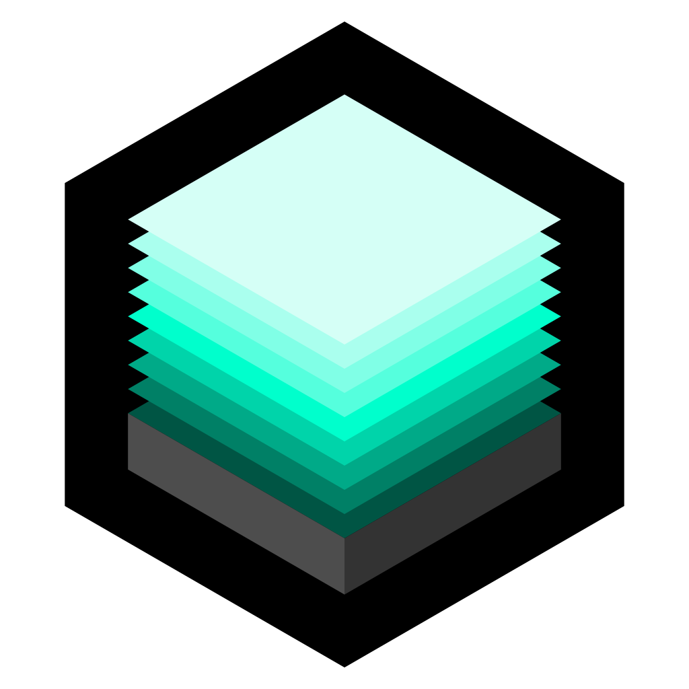

 <b>Foam Blaster Printed Parts + Mods</b> PEW! PEW!

---

 
Show your appreciation with a PayPal donation!

---

 
Useful? Star the repository - it helps others find it.

---

### Welcome to [Pew! Pew! Prints](https://pewpewprints.com)

All items are compatible with the following brand names (unless otherwise specified):

- Adventure Force [ AFX ]
- Dart Zone Pro [ DZP ]
- Dart Zone Max [ DZM ]
- Nerf [ NFX ]

List of owned Foam Blasters models used for parts testing:

- [ AFX ] Spectrum
- [ AFX ] Aeon Pro
- [ AFX ] Nexus Pro
- [ AFX ] Conquest Pro

- [ DZP ] MK 1.2
- [ DZP ] MK 2.1
- [ DZP ] MK 3

- [ DZM ] Stryker
- [ DZM ] Tomcat
- [ DZM ] Deuce Pro
- [ DZM ] Dictator

- [ NFX ] Mediator

---

### License:

Pew! Pew! Prints is free software released under the GNU General Public License version 3 - see 'LICENSE.md'.

---

### Reports:

[Submit bug report or feature request](https://github.com/nathaneltitane/pewpewprints/issues)

---

### Projects:

---

 
Show your appreciation with a PayPal donation!

---

 
Useful? Star the repository - it helps others find it.
